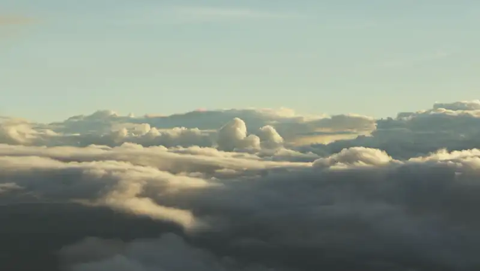
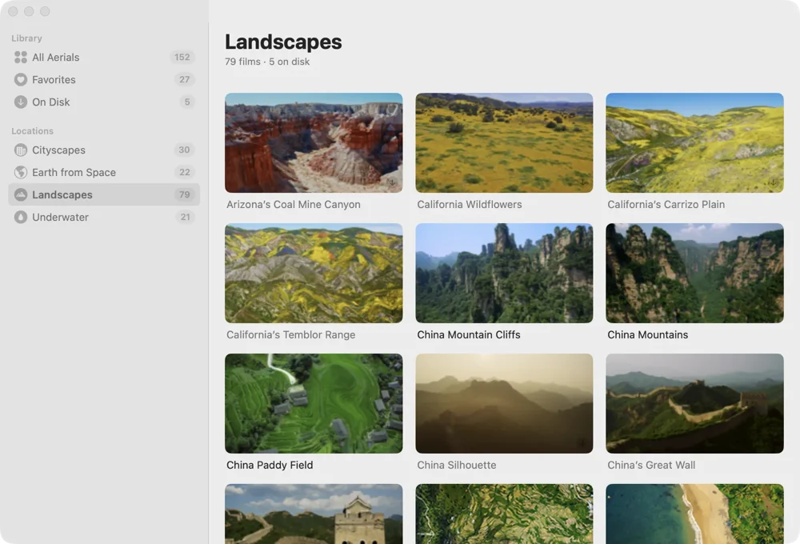
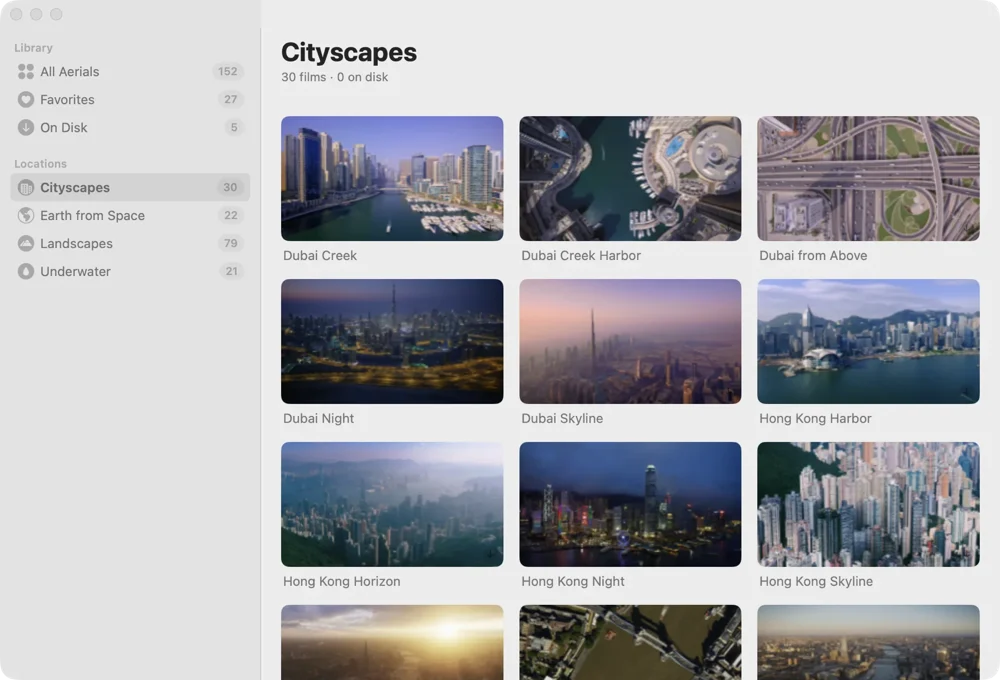
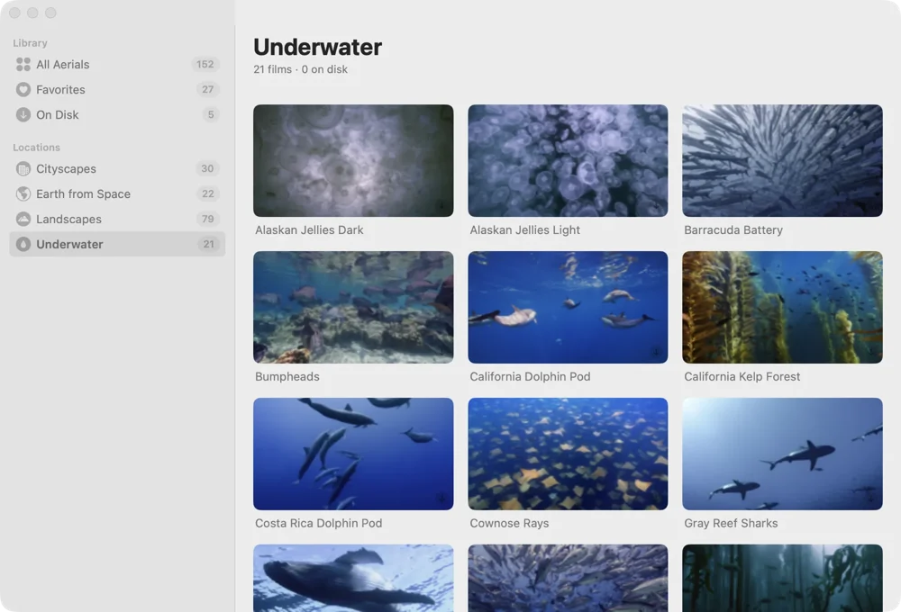
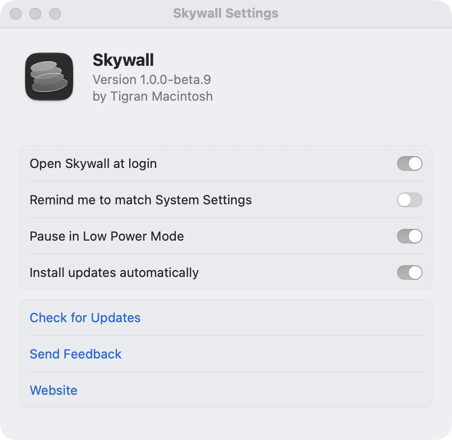

<h1 align="center">Skywall</h1>

Live wallpaper for the Mac. The aerial films macOS already ships, the ones behind the lock screen, playing full screen on your desktop.

  

  <a href="https://skywall.app/download/"><b>Download the free beta</b></a> · <a href="https://skywall.app">skywall.app</a> · <a href="https://skywall.app/changelog/">Changelog</a>

## The whole collection, by place

<picture>
  <source media="(prefers-color-scheme: dark)" srcset="docs/window-landscapes-dark.webp">
  
</picture>

<table>
<tr>
<td align="center" width="33%"><picture><source media="(prefers-color-scheme: dark)" srcset="docs/landscapes-dark.webp"></picture> <b>Landscapes</b> mountains, coasts, clouds</td>
<td align="center" width="33%"><picture><source media="(prefers-color-scheme: dark)" srcset="docs/cityscapes-dark.webp"></picture> <b>Cityscapes</b> skylines from above</td>
<td align="center" width="33%"><picture><source media="(prefers-color-scheme: dark)" srcset="docs/underwater-dark.webp"></picture> <b>Underwater</b> reefs and open water</td>
</tr>
</table>

Pick a film and it becomes the wallpaper on every display. Films download only when you choose them, into the folder where the system keeps its own copies, so nothing is stored twice.

## Quiet when it should be

| When | Skywall |
|---|---|
| A full-screen app covers the desktop | pauses |
| The display sleeps, the Mac locks or the screen saver starts | pauses |
| The Mac runs hot | pauses |
| Low Power Mode is on | pauses, or keeps playing at half speed if you prefer |
| You quit it | the desktop goes back to the wallpaper you had |

It lives in the menu bar with no dock icon, and decoding runs on the same hardware the system uses for its own screen saver.

## Settings

  <picture>
    <source media="(prefers-color-scheme: dark)" srcset="docs/settings-dark.webp">
    
  </picture>

## Download

Get the free open beta from [skywall.app/download](https://skywall.app/download/) or the [latest release](../../releases/latest). It needs macOS 14 or later and runs on Intel and current Macs alike. The app is signed and notarised, so it opens straight away, and it updates itself with your say-so.

## Feedback

Open an issue here, or use the [form](https://skywall.app/feedback/) if you would rather write in private. Bug reports help most with the Skywall version, the macOS version and how many displays you have.

## Privacy

No analytics, no account, no telemetry. The app goes online only to download films and preview images. The full text is at [skywall.app/legal/privacy](https://skywall.app/legal/privacy/).

The source is not in this repository: it holds the releases, the issue tracker and this page. © 2026 Tigran Macintosh.
