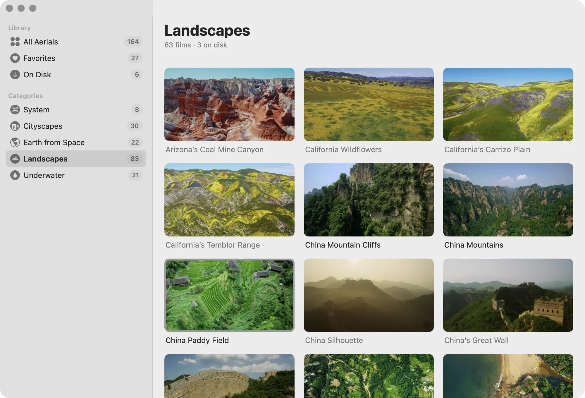
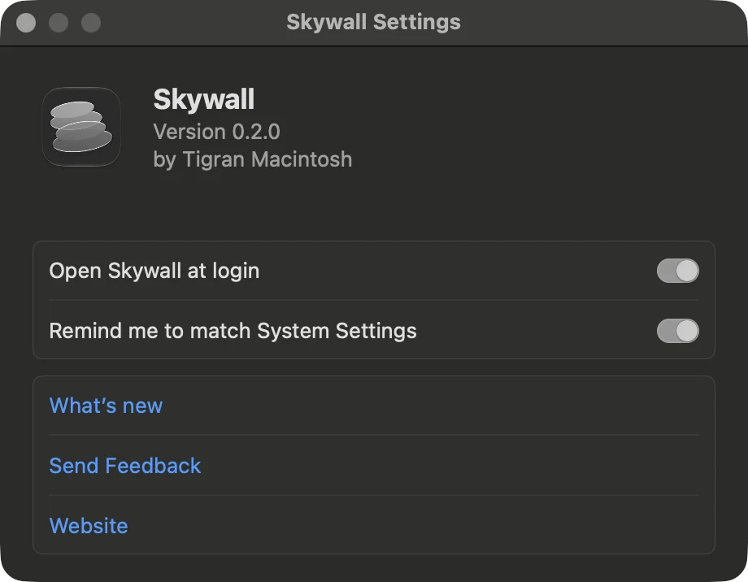

# Skywall

Live wallpaper for the Mac. Skywall plays the aerial films macOS already ships — the ones the system shows behind the lock screen — full screen on the desktop, from the menu bar.

<picture>
  <source media="(prefers-color-scheme: dark)" srcset="docs/window-landscapes-dark.webp">
  
</picture>

## What it does

- Plays a film as the desktop wallpaper on every display, in place of a still image.
- Lists the whole built-in collection by category and downloads only the films you pick. They go where the system keeps its own copies, so nothing is stored twice.
- Pauses when the Mac is locked, asleep, running hot or in Low Power Mode, and halves the frame rate on battery.
- Stays in the menu bar with no dock icon. Quit it and the desktop goes back to the wallpaper you had.

## Requirements

macOS 14 or later, on both Intel and current Macs. The build is universal and signed.

## Download

Not yet. The first public build will be a free open beta on [skywall.app](https://skywall.app). Watch this repository to hear about it, or read the [changelog](https://skywall.app/changelog/).

## Feedback

Open an issue here, or use the [form](https://skywall.app/feedback/) if you would rather write in private. Bug reports are most useful with the Skywall version, the macOS version and how many displays you have.

## Privacy

No analytics, no account, no telemetry. The app talks to the network only to download films and preview images, and the site loads nothing from anyone else. The full text is at [skywall.app/legal/privacy](https://skywall.app/legal/privacy/).

## Source

The source is not in this repository. What lives here is the release, the issue tracker and this page.

© 2026 Tigran Mhitaryan.
